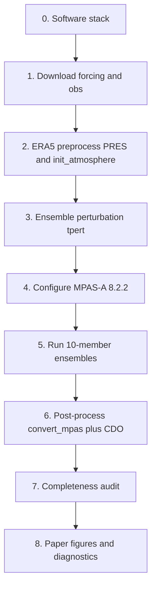

# MPAS Paper 1 workflow

End-to-end workflow documentation for the Gauteng extreme-rainfall MPAS ensemble
study (February 2019, January 2020, November 2022).

This repository records **every major stage** from data download through
perturbation, model setup, runs, post-processing, and publication analysis on
CHPC Lengau — written so another researcher can follow (and, with archived data +
code, reproduce) what was done.

> **Reproducibility status:** start with
> **[REPRODUCIBILITY.md](REPRODUCIBILITY.md)**.  
> This repo is a complete *workflow guide*. Multi-TB mesh/output/obs and the full
> Python analysis tree still live on Lustre; they are not vendored here.

---

## Pipeline at a glance



| Step | What | Doc |
|---|---|---|
| 0 | Lengau modules, conda, PBS | [00_software_stack](docs/00_software_stack.md) |
| 1 | ERA5 / CHIRPS / GPCP / SAWS | [01_forcing_downloads](docs/01_forcing_downloads.md) |
| 2 | `PRES:` intermediates, statics, init | [02b_era5_preprocess_and_init](docs/02b_era5_preprocess_and_init.md) |
| 3 | Member perturbations | [02c_ensemble_perturbation](docs/02c_ensemble_perturbation.md) |
| 4 | Mesh, physics, namelist | [02_mpas_setup](docs/02_mpas_setup.md) |
| 5 | PBS atmosphere runs | [03_running_simulations](docs/03_running_simulations.md) |
| 6–7 | `convert_mpas`, CDO, audit | [04_postprocessing](docs/04_postprocessing.md) |
| 8 | Figures + analysis software | [05](docs/05_publication_figures.md), [06](docs/06_analysis_software.md) |

Linear checklist: **[WORKFLOW.md](WORKFLOW.md)**.

---

## Quick start (analysis, after data exist on Lustre)

```bash
cd /home/$USER/lustre/MPAS/2025/era_runs/postprocessing/publication_figures
qsub revised_dynstat/run_audit.pbs
qsub paper_draft_figures/run_paper_figures.pbs
qsub revised_dynstat/run.pbs
qsub paper_draft_figures/run_diagnostics.pbs
```

**Internet downloads** (CDS, etc.): use `scp.chpc.ac.za` or `dtn.chpc.ac.za`.

---

## Key scientific choices (fixed for Paper 1)

- **Model:** MPAS-Atmosphere **8.2.2**, mesh `x20.835586` (~3–60 km), suite `mesoscale_reference`
- **Ensemble:** 10 members (`ENSB01`–`ENSB10`); perturbations in 24–32°E, 28–24°S
  (see [02c](docs/02c_ensemble_perturbation.md))
- **Inits:** 00 UTC 9 Feb 2019, 7 Jan 2020, 1 Nov 2022 (ERA5 PRES + 6-hourly SST)
- **Vertical motion:** MPAS `wa` (m s⁻¹); ERA5 `w` is ω → \(w=-\omega/(\rho g)\)
- **Rainfall products:** SAWS station max ≠ SAWS box mean ≠ CHIRPS ≠ MPAS box mean

---

## Licence

Documentation and example scripts: MIT (see [LICENSE](LICENSE)).  
MPAS, ERA5, CHIRPS, GPCP, and SAWS data remain under their respective licences.
