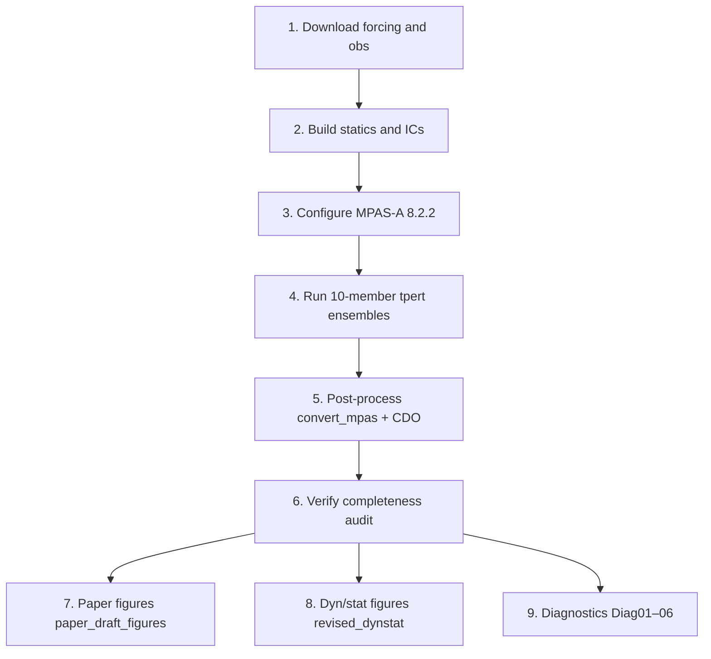

# MPAS Paper 1 workflow

End-to-end, cleaned workflow for the Gauteng extreme-rainfall MPAS ensemble study
(February 2019, January 2020, November 2022).

This repository documents **how the simulations and publication figures were produced**, from ERA5 forcing downloads through MPAS setup, ensemble runs, post-processing, and figure scripts on CHPC Lengau.

Companion analysis code lives in the `paper1_analysis` working tree (Lengau: `…/postprocessing/publication_figures/`). This repo is the **workflow guide**, not a dump of model binaries or multi-TB output.

---

## Pipeline at a glance



| Step | What | Where (Lengau) |
|---|---|---|
| 1 | ERA5 / CHIRPS / GPCP / SAWS | `postprocessing/Obs_data/` |
| 2–4 | Mesh, init, atmosphere runs | `era_runs/…/6003km_outputs/` |
| 5 | `convert_mpas` → `*_hrs_*.nc` | `*_ensemble_postprocessed_data/` |
| 6–9 | Python + PBS figure jobs | `postprocessing/publication_figures/` |

---

## Documents in this repo

| File | Content |
|---|---|
| [WORKFLOW.md](WORKFLOW.md) | Single step-by-step checklist |
| [docs/01_forcing_downloads.md](docs/01_forcing_downloads.md) | ERA5, precip products, SAWS |
| [docs/02_mpas_setup.md](docs/02_mpas_setup.md) | Mesh, statics, physics, init |
| [docs/03_running_simulations.md](docs/03_running_simulations.md) | Ensemble runs on Lengau |
| [docs/04_postprocessing.md](docs/04_postprocessing.md) | `convert_mpas`, CDO, re-post |
| [docs/05_publication_figures.md](docs/05_publication_figures.md) | Scripts and PBS for all figures |
| [docs/paths_and_conventions.md](docs/paths_and_conventions.md) | Paths, boxes, events, units |
| [scripts/](scripts/) | Example CDS / helper scripts |

---

## Quick start (after data exist on Lustre)

```bash
# On Lengau login (or scp.chpc.ac.za for downloads)
cd /home/$USER/lustre/MPAS/2025/era_runs/postprocessing/publication_figures

# Audit ensemble post-processed fields
qsub revised_dynstat/run_audit.pbs

# Manuscript Figs 1–6 (+ 2b)
qsub paper_draft_figures/run_paper_figures.pbs

# Revised dyn/stat Figures A–D
qsub revised_dynstat/run.pbs

# Extra diagnostics Diag01–06
qsub paper_draft_figures/run_diagnostics.pbs
```

**Internet downloads** (CDS, etc.): use `scp.chpc.ac.za` or `dtn.chpc.ac.za`, not the shared login node.

---

## Key scientific choices (fixed for Paper 1)

- **Model:** MPAS-Atmosphere **8.2.2**, mesh `x20.835586` (~3–60 km), suite `mesoscale_reference`
- **Ensemble:** 10 members (`ENSB01`–`ENSB10`), temperature perturbations (`*_tpert`)
- **Inits:** 00 UTC 9 Feb 2019, 7 Jan 2020, 1 Nov 2022 (ERA5 PRES + 6-hourly SST)
- **Vertical motion:** MPAS archives kinematic `wa` (m s⁻¹); ERA5 `w` is ω (Pa s⁻¹) → convert with \(w=-\omega/(\rho g)\) before comparison
- **Rainfall products:** SAWS station max (time series) ≠ SAWS box mean (event totals) ≠ CHIRPS (skill) ≠ MPAS box mean

---

## Licence

Documentation and example scripts: MIT (see [LICENSE](LICENSE)).  
MPAS, ERA5, CHIRPS, GPCP, and SAWS data remain under their respective licences and terms of use.
